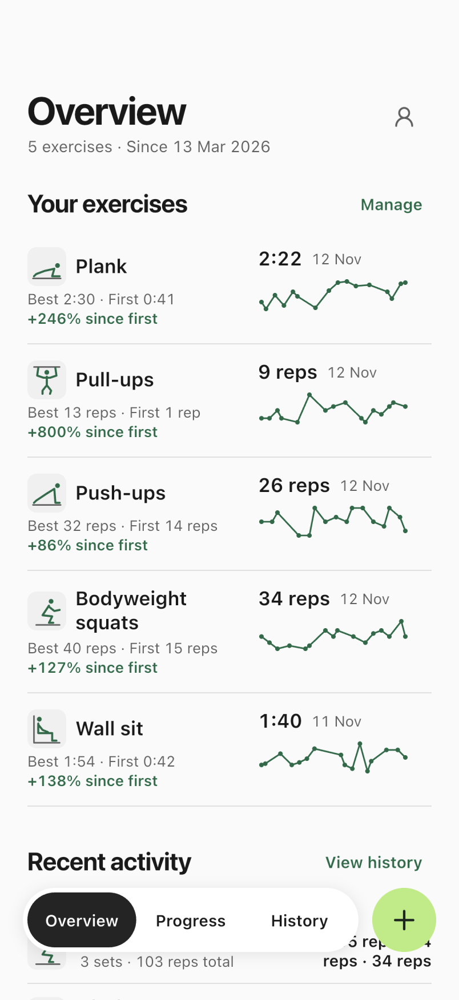
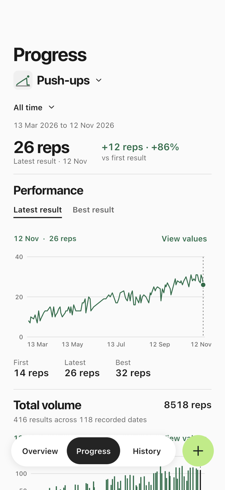
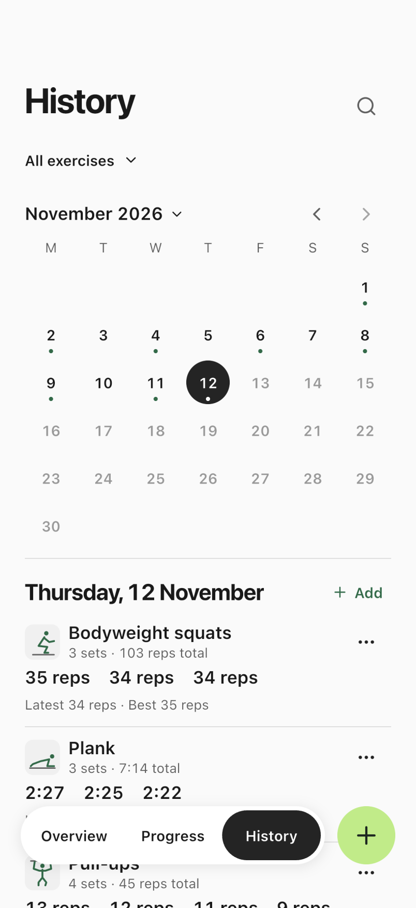
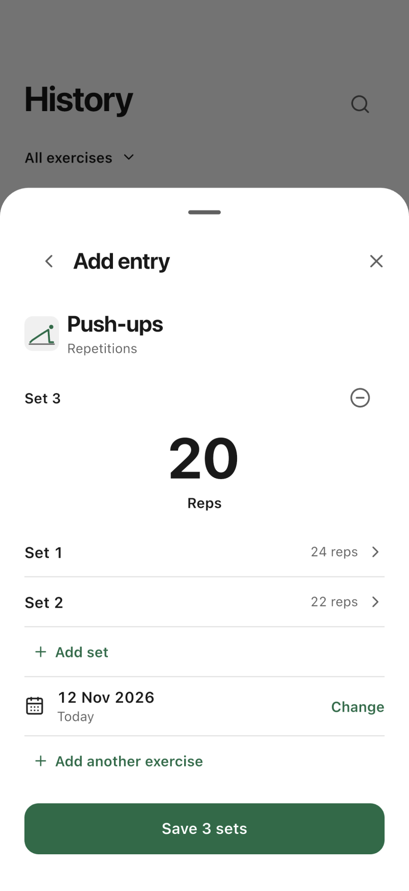

<div align="center">
  
  <h1>Fitness Tracker</h1>
  <p>An offline workout log for iPhone, iPad, and Android.</p>
  <p><a href="https://fitness-tracker.dhibi.tn/downloads/">Android downloads</a> · <a href="#run-locally">Run locally</a> · <a href="docs/README.md">Docs</a> · <a href="CONTRIBUTING.md">Contribute</a> · <a href="LICENSE">MIT license</a></p>
</div>

Log reps, timed efforts, and weight with or without reps. Compare your results over time, revisit workouts in a calendar, and set personal goals. The app starts with an empty log and stores your records on your device. You can export a restorable JSON backup or a CSV for analysis.

## Screenshots

Captured on an iPhone simulator with fictional workouts.

| Overview | Progress | History | Log |
| :---: | :---: | :---: | :---: |
| <a href="docs/screenshots/overview.webp"></a> | <a href="docs/screenshots/progress.webp"></a> | <a href="docs/screenshots/history.webp"></a> | <a href="docs/screenshots/log.webp"></a> |

## Run locally

Follow [Flutter's installation guide](https://docs.flutter.dev/install) and use [Flutter 3.47.5](https://docs.flutter.dev/install/archive), which includes Dart 3.13.4. Once Flutter is on your PATH, you can run the [host checks](docs/testing.md#run-host-checks) on Windows, macOS, or Linux without a device or mobile SDK.

To launch the app, set up an [Android target](https://docs.flutter.dev/platform-integration/android/setup) on Windows, macOS, or Linux, or an [iOS target](https://docs.flutter.dev/platform-integration/ios/setup) with Xcode on macOS. The app runs on Android, iPhone, and iPad. Windows, macOS, and Linux are development hosts.

From the repository root, run:

```text
flutter doctor
flutter pub get
flutter devices
flutter run -d DEVICE_ID
```

Replace `DEVICE_ID` with the ID of your emulator, simulator, or connected device. In `flutter doctor`, focus on the toolchain for your target. The app needs no account, Firebase project, or API keys. To try it with sample workouts, [generate a demo backup](docs/testing.md#load-fictional-demo-workouts).

## Contribute

Read the [contribution guide](CONTRIBUTING.md) for local checks, issue reports, and pull requests. The [docs index](docs/README.md) links to the architecture, data formats, design rules, and screenshot capture instructions. Use the [private reporting instructions](SECURITY.md) for security issues.

## License

Project source is available under the [MIT License](LICENSE). See [third-party notices](THIRD_PARTY_NOTICES.md) for material covered by other terms.
